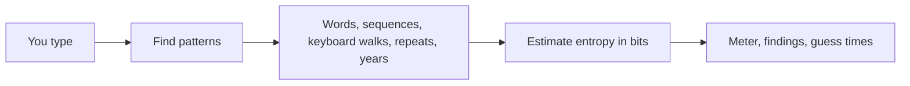

<p align="center"></p>

# PassCheck 🔐

**Is your password actually strong?** Type one in and find out, and don't worry: it never leaves your browser. 🙈

No servers, no storage, no logs, no analytics. Everything happens on your device.

## 🛡️ The privacy promise

A password checker is only worth using if it keeps its mouth shut. Here is exactly what PassCheck does and doesn't do:

| | |
| --- | --- |
| ✅ Analyzes locally | All the math runs in your browser tab |
| 🚫 Sends anything | No API, no server, no analytics, no external scripts or fonts |
| 🚫 Stores the password | Not in cookies, local storage, session storage or anywhere else |
| 🚫 Logs the password | The code never writes it to the console |
| 🚫 Puts it in the URL | It lives only in the input field, and the field is emptied when you leave the page |
| 🧠 Remembers one thing | Your light or dark theme choice, nothing else |

The page also ships a **Content Security Policy** that tells the browser to block every outside connection, so even a future bug could not phone home. Want proof? Open DevTools, go to the Network tab, and type. You will see nothing.

## ✨ What you get

- 📊 **A five-step strength meter**: Very weak, Weak, Fair, Strong, Very strong
- 🔎 **Useful details**: length, character types, unique characters, estimated entropy
- 🧩 **Pattern spotting**: common passwords, common words with swaps like `@` for `a`, sequences, keyboard walks, repeats and year-like numbers
- ⏱️ **Two guessing scenarios**: a throttled online attack and an offline attack on a fast hash
- 💬 **Plain-language explanations** of what's weak, plus tips to do better
- 🧪 **Fictional examples** you can click to see how it reacts
- ♿ **Accessible**: labeled input, live status updates, keyboard friendly, visible focus, reduced-motion support
- 🌙 **Dark and light themes**

## 🚀 Run it

```bash
git clone https://github.com/CyberLoop-dev/passcheck.git
cd passcheck
python3 -m http.server 8000   # then open http://localhost:8000
```

Serving it from a local server is the most reliable way, because the strict security policy only allows files from the same origin. Some browsers are fussy about that when you open `index.html` straight from disk.

## 🧭 How it works



The checker finds predictable chunks, charges each one a small number of bits, and charges every remaining character based on the character types you used. More bits means more guesses an attacker would need.

## 📁 Project structure

```text
passcheck/
├── index.html   # page and security policy
├── styles.css   # themes and components
├── app.js       # the whole analyzer, no dependencies
└── assets/      # logo and README banner
```

## ⚠️ Please read this

These are **educational estimates, not guarantees**. PassCheck uses a simple model and a deliberately small word list, so:

- It can rate a password higher than a real attacker with a big wordlist would.
- It does **not** check breach databases, so a password it likes may still have leaked somewhere.
- A good score doesn't make a password unbreakable.

For extra caution, test the *pattern* of a password rather than the real thing, and use a password manager for the real ones.

## 💡 Ideas for later

- A bigger bundled word list
- Offline breach checking with a local k-anonymity file
- A passphrase generator using the browser's secure random source

## 🤝 Contributing

Issues and pull requests are welcome. The rule is simple: no network calls, no storage of passwords, no logging. Ever.

## 📄 License

[MIT](LICENSE)
